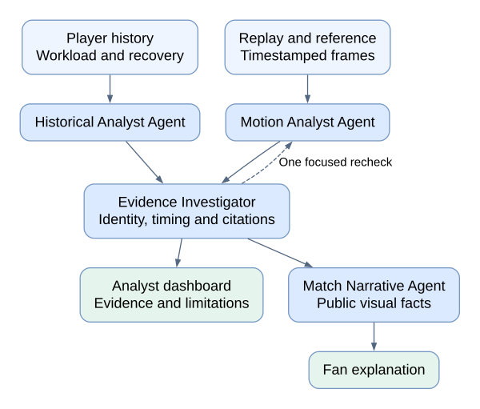
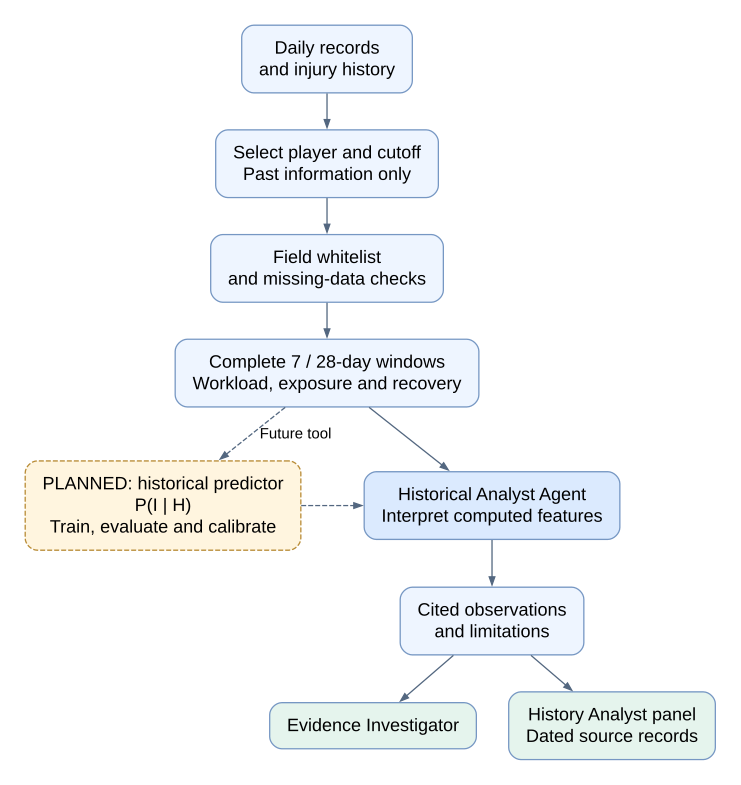
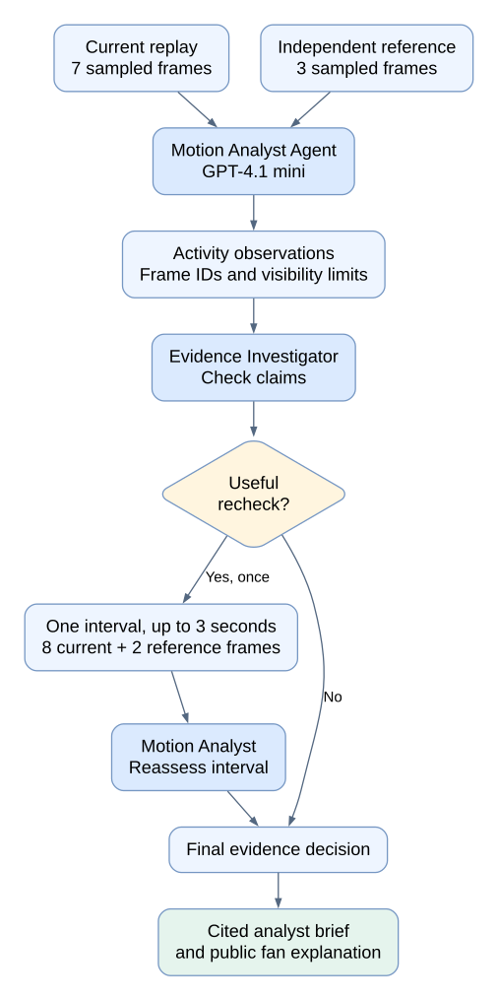

# PitchGuard AI

**[Open the live Azure demo](https://pgdemo-web.purpleground-33ee8913.francecentral.azurecontainerapps.io/) · [Watch Demo Video](https://www.youtube.com/watch?v=ezsUFydyIyI)**

Microsoft Premier League Hackathon · Explainable football analysis through player history, movement evidence, and multi-agent collaboration.

## Project description

PitchGuard connects a player's historical health and workload context with observations from current movement. It helps football analysts understand the background and inspect the evidence behind AI-generated statements. A separate fan view turns accepted public visual facts into a simpler replay explanation.

Our sports science adviser guided the selection of previous injuries, match and training exposure, workload, sleep, fatigue, and muscle soreness as candidate monitoring variables. Optional physiological measures include resting heart rate and heart-rate variability. These variables provide context for modeling; an isolated measurement does not establish that a player will be injured.

The prototype uses synthetic data because longitudinal player monitoring records are often private. Its frozen historical dataset contains **7,000 daily records for 25 fictional players over 280 days**, plus **30 injury events**, including 20 non-contact events. Procedural Blender animations provide stable movement, slowing, occlusion, and a matched symmetric/asymmetric gait pair. S004 and S006 share the same avatar, camera, speed, and path for a controlled comparison of step patterns.

Microsoft Agent Framework coordinates specialist roles. Deterministic code first computes historical summaries using completed days before the match. The Historical Analyst interprets these features, the Motion Analyst examines ordered video frames, and the Evidence Investigator reconciles their claims and can request one targeted visual recheck. Each observation cites dated records or source frames. The Match Narrative Agent receives accepted public visual facts for the fan explanation.

The long-term prediction target is a **new non-contact injury causing time loss within the next seven days**. The current Agent workflow produces qualitative observations. A separate paired simulator demonstrates how history and actual video measurements jointly affect a synthetic event probability. A trained, independently evaluated and calibrated joint injury predictor is a future extension.

## Try the two demos

### 1. Movement evidence

- Open the live site in **Analyst** mode. The default replay loads a saved result from a real Azure Agent run.
- Use **Play both from 5s** to compare S006 and S004. The authored step-pattern difference is not a diagnosis or proof that the model recognized it.
- Inspect **History Analyst**: the example player had no match minutes in the preceding week but completed 393 minutes of training.
- Click a date or frame citation in **Evidence Desk** to inspect the supporting record or image and timestamp.
- Switch to **Fan view** to see public visual facts without the internal wellness history.

Saved cases are explicitly labeled. Machine observations still require human review; a valid citation does not prove a statement is correct. The current implementation analyzes sampled replay frames; continuous live tracking has not been validated.

### 2. Paired probability demo

Open **Paired probability demo**, select S006, then S004. Historical inputs remain identical while measured movement changes:

| Featured comparison | S006: symmetric gait | S004: asymmetric gait |
| --- | --- | --- |
| Mean fatigue | 2/5 | 2/5 |
| History-only simulator probability | 9.27% | 9.27% |
| Measured step-span variation | 0.0323 | 0.2328 |
| History + video simulator probability | 4.13% | 14.42% |

The UI rounds probabilities to one decimal place. Video features come from decoded pixels, not scenario IDs or future labels. The gait proxy measures variation in shoe-separation peaks in these fixed-camera clips. The simulator uses mean fatigue and measured movement state; workload and sleep are contextual displays in this panel.

**These percentages follow a declared synthetic stochastic process. They are not trained or clinically validated injury predictions, and they are not generated by the qualitative Agent workflow.** Six what-if cases are available; they are not a predictive evaluation cohort. See the [simulator specification](data/demo/README.md) for the event law and limitations.

Browsing videos, saved cases, evidence, and simulations is free and requires no login. New analyses require a privately supplied analysis code and are subject to per-code and global budgets. Saved or cached results do not consume the allowance. For test access, contact [Charlie](mailto:cys620999@gmail.com); judge credentials should be supplied separately with submission testing instructions.

## Agent system architecture



[View full-size diagram](docs/images/agent-system.svg) · [Editable diagram source](docs/images/agent-system.dot)

The diagram shows the implemented evidence workflow. The paired probability simulator remains separate; a trained joint predictor is a future extension.

The specialists execute concurrently. The investigator checks evidence identity, timing, and uncertainty rather than voting on percentages. All four roles share one model deployment with distinct prompts and permissions. The analyst brief reuses accepted investigator rationale; fan narration receives only public visual facts.

## Historical Analyst Agent workflow



[View full-size diagram](docs/images/historical-agent.svg) · [Editable diagram source](docs/images/historical-agent.dot)

Future injury labels, generator formulas, and future rows never enter runtime prompts. Missing windows remain unavailable rather than zero. Unresolved distance, recovery-date, ACWR, and source rolling-feature definitions are excluded from current summaries. Source IDs and hashes support traceability. See the [runtime data dictionary](data/DATA_DICTIONARY.md) and [source provenance](data/source/README.md).

## Visual analysis Agent workflow



[View full-size diagram](docs/images/visual-agent.svg) · [Editable diagram source](docs/images/visual-agent.dot)

Recheck images replace the initial set rather than accumulating. Sparse frames can miss movement, and occlusion remains explicit uncertainty. The Agent does not infer pain, tissue damage, or a medical diagnosis. Quantitative gait measurement in the separate simulator uses a deterministic pixel extractor, not the Agent's natural-language observations.

## Azure deployment

The public application was deployed on **October 26, 2026**, in **France Central**.

| Technology | Role |
| --- | --- |
| Azure OpenAI in Microsoft Foundry | Shared GPT-4.1 mini text and image inference |
| Microsoft Agent Framework | Concurrent specialists, investigator handoffs, bounded recheck |
| Azure Container Apps | HTTPS hosting for React and FastAPI |
| Azure Container Apps Jobs | Finite, on-demand Agent analysis executions |
| Azure Blob Storage | Durable cases, caches, budgets, and code-usage state |
| Azure Container Registry | Versioned application container images |
| Application Insights and Log Analytics | Application telemetry and logs |
| Managed identities and Azure RBAC | Scoped storage, image-pull, and job-dispatch access |

The web application keeps one 0.5-vCPU / 1-GiB replica. New analysis runs in a separate finite CPU Job; media ships in the immutable image. The release verified a complete cloud workflow, duplicate-request handling without a second allowance charge, and persistence of results and quota across a web revision restart. Load testing, independent visual accuracy, and medical validation are not established by those checks.

See [deployment and setup](docs/DEPLOYMENT.md), [Azure release details](docs/AZURE_ISOLATED_RELEASE.md), and [judge testing instructions](docs/JUDGE_TESTING.md).

## Run locally

Requires Python 3.12+, Node.js 22.12+, and rendered runtime media. A clean clone does not include generated MP4s or PNG sequences: copy the existing team media bundle or follow the [animation rebuild guide](data/animation/README.md).

```powershell
python -m venv .venv
.\.venv\Scripts\python.exe -m pip install -r requirements.txt
npm.cmd --prefix src/frontend ci
npm.cmd --prefix src/frontend run build
# For a new checkout only: copy .env.example to .env and configure Foundry.
# Preserve any existing configured .env.
.\scripts\run_demo.ps1
```

Open `http://127.0.0.1:8000`. The paired simulator needs no model calls once media and measured artifacts are available. New Agent analyses require a compatible Azure deployment and server-side credentials. Changed video bytes require remeasurement; see [paired demo data](data/demo/README.md).

Offline checks do not call the model:

```powershell
.\.venv\Scripts\python.exe -m unittest discover -s tests -v
.\.venv\Scripts\python.exe -m unittest discover -s scripts/animation -v
npm.cmd --prefix src/frontend run build
```

The isolated release recorded 29 backend checks, 7 animation checks, a frontend build, and desktop/mobile browser checks. Successful software checks do not establish prediction or visual accuracy. See [implementation status](docs/IMPLEMENTATION_STATUS.md) for limitations.

Never commit `.env`, access codes, local state, authentication sessions, or private release backups. Runtime images exclude future-label artifacts. A trained model experiment is preserved separately on `codex/teammate-model`; it is not wired into this application.

## Team and acknowledgements

Thank you to every team member and adviser for contributing software engineering, data analysis, and sports science expertise:

| Team member | Contribution |
| --- | --- |
| **Charlie — Team Lead** | Multi-agent architecture design and orchestration |
| **Frances** | Data analysis and synthetic data |
| **Eden** | Sports science adviser |
| **Henry** | Visual analysis approach adviser |
