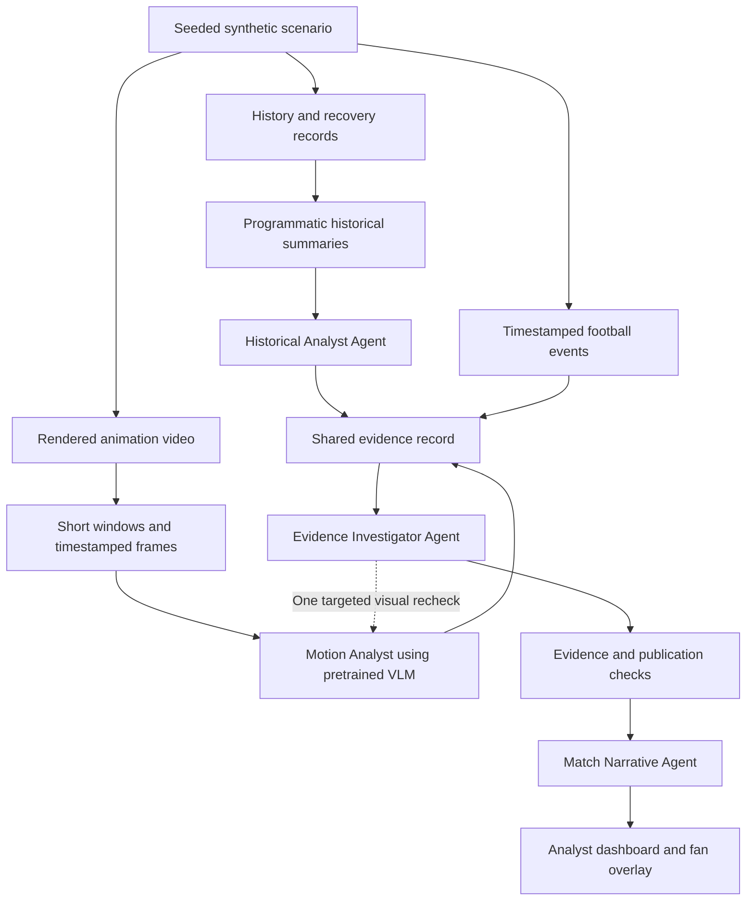

# PitchGuard AI: hackathon agent architecture

Status: design with a local implementation as of 2026-10-23. See [implementation status](IMPLEMENTATION_STATUS.md) and [runbook](RUNBOOK.md) for verified behavior and remaining gaps. The MVP uses pretrained vision-language inference and programmatic summaries without model training. Not every proposed hosting/evaluation capability below has been delivered.

## Scope and output contract

Turn synthetic football events, player history and animation into explainable player-focused match intelligence. Historical and motion agents produce evidence for an analyst view and a simpler fan overlay.

The data specification's longer-term target remains a new non-contact, time-loss injury within seven days. The hackathon MVP produces an evidence-grounded concern level and review flag. These are qualitative assessments, not calibrated injury probabilities. Do not ask an LLM to invent a percentage. Return `injury_probability: null` and `probability_status: not_validated` until an independently validated predictor is available.

Training a pose estimator, temporal neural network or injury predictor is not an MVP dependency. A separate pose pipeline is also optional. Historical sums, counts and changes are calculated by ordinary code, with units, cutoffs and source IDs; the LLM interprets those results and explains limitations.

## Architecture



Use one backend and one frontend. Microsoft Agent Framework manages concurrent specialist work, timeouts and a bounded recheck. One image-capable Foundry model deployment may serve all four agent roles with different prompts and tool permissions. Confirm the actual model/API/region supports the required image count and structured-output behavior before choosing it. No model self-hosting is required.

| Agent | Work and tools | Output |
|---|---|---|
| Historical Analyst | Inspect computed windows, exposure, recovery, prior injury records and missingness with `get_history_summary` and `get_history_evidence` | Concerning or reassuring patterns, exact source IDs, cutoff and limitations; no invented percentage |
| Motion Analyst | Inspect timestamped frames and comparable baseline frames using `get_frames` and `get_reference_frames`; request one denser window if necessary | Visible observations, evidence frame IDs, coarse intervals, visibility status and need for review |
| Evidence Investigator | Check whether evidence matches the player, time and activity; request a specific recheck via `request_visual_recheck` | Accepted/rejected evidence, unresolved uncertainties and a qualitative concern/review assessment |
| Match Narrative | Use only accepted evidence and audience-filtered context | Analyst explanation, fan explanation and synchronized overlay payload |

Agents do not vote on percentages. The investigator explains how history and visible activity relate, preserving each source's uncertainty. A normal-looking clip does not prove low injury risk; concerning history does not prove a visual abnormality.

## Direct visual reasoning without training

Runtime path: `animation -> short window -> timestamped ordered frames -> pretrained VLM -> structured observations`.

Native video input is an alternative only when the selected provider/model/API explicitly supports it. Do not assume an image-capable endpoint accepts MP4. The portable MVP sends multiple ordered images with timestamps and a short prompt. This is sampled-frame analysis and may miss motion between frames.

Initial proposal: use one focused fictional player in a clearly visible, consistent camera view. Inspect five-to-ten-second windows, beginning with roughly 8-12 frames per window. These are tuning values, not measured recommendations for injury detection. Include a small same-player reference set showing the same activity. For an ambiguous interval, the investigator can request denser frames from that interval once. Avoid resending the whole match or an accumulating image history.

Ask the VLM to describe coarse visible changes such as an obvious slowdown, asymmetric-looking running or loss of balance, identify supporting frame IDs and state when the view is insufficient. Do not request exact stride timing, joint angles, speed, force, pain or tissue diagnosis from sparse images. Model self-reported confidence is not measurement accuracy or injury probability. The output can be `review`, `no_clear_change` or `insufficient_view`, with observations kept separate from hypotheses.

Illustrative output contract, not a real inference result:

```json
{
  "case_id": "scenario-a:player-07:window-068",
  "player_id": "player-07",
  "window_ms": [4075000, 4080000],
  "view_status": "insufficient",
  "observations": [],
  "evidence_frame_ids": [],
  "limitations": ["Target player's legs are obscured"],
  "review_status": "insufficient_view",
  "requested_recheck": {"start_ms": 4077000, "end_ms": 4079000},
  "injury_probability": null,
  "probability_status": "not_validated"
}
```

Validate the JSON shape and frame IDs. Check temporal/player references and block unsupported percentages or diagnoses. A valid citation does not prove the visual claim: use held-out labeled clips and human inspection to assess observation quality. Rechecking with the same model is another look, not independent verification.

## Animation and evidence integrity

See the [synthetic animation production plan](SYNTHETIC_ANIMATION_PLAN.md) for the scene list, production steps, frame/time contract and acceptance checklist.

Use one scenario clock and stable IDs across history, events and animation. The user selected GPT-authored Blender Python scripts to create a solid simplified humanoid, joint motion, scene and rendered frames. Reuse one tested generation script with scenario configurations; no external character or animation library is an MVP dependency. Inspect short previews before batch rendering, because procedural motion quality and VLM readability are not guaranteed. Test normal motion, clear deviations, benign style differences, occlusion and camera changes. Do not imply synthetic success establishes real broadcast or medical performance.

Keep intended animation labels, renderer coordinates and future outcomes in separate evaluation artifacts. Runtime VLM receives frames, necessary identity/activity context and reference images, not hidden labels, future injuries, revealing filenames or captions such as “injured player.” A highlighted target may identify the player but must not reveal the scenario label. Agent outputs must come from actual inference, not scripted scenario answers.

Describe the experience as analysis of a synthetic replay, with processing delay shown. Pre-rendering the animation is fine; disclose any precomputed analysis. Do not promise frame-by-frame live analysis. Generate baseline and current clips consistently so the model cannot solve the task from unrelated visual styling.

## Historical path without training

Compute past workload sums, exposure, injury counts, days since prior injury/return, recovery trends and missingness at an explicit cutoff. Retain raw evidence references and feature definitions. Query only past injury records; future labels are evaluation data. If data are insufficient, report that rather than filling in physiological measurements.

The historical agent can describe patterns and recommend review within this prototype. If a trained, tested predictor is added later, expose it through a tool and show its target, cutoff, calibration and model version separately. The existing generator's injury probability is a simulator assumption; it is not a validated predictor or a ground-truth real-player risk estimate.

## Shared state, workflow and failures

Each case stores scenario/player/window IDs, input revision, history cutoff, frame manifest, agent observations, accepted/rejected evidence, concern level, `injury_probability: null`, publication status and trace ID. Each agent owns its output namespace. Merge results against one immutable input revision and reject stale recheck results.

Workflow: `RECEIVED -> SUMMARIZED -> SPECIALISTS -> RECONCILED -> CHECKED -> PUBLISHED`, with explicit degraded/abstained outcomes. Cache history per snapshot and motion per exact frame/prompt/model revision. Use periodic completed windows or user-selected clips as the MVP trigger; no separate CV detector is required to trigger VLM analysis.

Default budget: history reasoning once per changed history snapshot; one VLM call per selected window; investigator and narrator once per investigated case; at most one visual recheck, a global call/token budget and a total timeout. Benchmark actual latency/cost rather than promising an eight-second result. On timeout, render existing verified observations with an unavailable status for unfinished branches.

Handle obscured/wrong-player frames by abstaining or rechecking; missing history by motion-only commentary; missing video by history-only commentary; unresolved disagreement by retaining uncertainty. Deduplicate replay events and merge overlapping alerts into one episode. Human acknowledgement is a UI review record, never an injury label.

Keep credentials on the backend, tools allowlisted and audience context filtered before model calls. Analyst mode may show synthetic recovery records and evidence. Fan mode should describe observed match activity and tactical context, without unsupported injury probabilities or private wellness details.

## Hosting and minimal interfaces

Suggested implementation: React frontend, FastAPI backend, Agent Framework, one configurable image-capable Foundry deployment and tracing. Use Blob Storage for hosted video/evidence; avoid durable state on ephemeral container disk. An in-process case store is sufficient for an initial local single-session demo; add durable cases if hosting/resume requires it. Do not add a separate pose service, GPU server, queue or training job for MVP.

Useful endpoints: start/replay a scenario, get its event stream, fetch a case's evidence, request a bounded investigation, and record acknowledgement. The UI shows clip time, source frames, history cutoff, qualitative status, reasoning and limitations. Foundry/OpenTelemetry traces should show actual agent inputs, tools, handoffs and fallback behavior, with appropriate data/secret filtering.

## Evaluation and build order

Build a small held-out set of controlled clips: normal activity, visible deviation, benign asymmetry, occlusion, wrong identity, missing history/video and model timeout. Start with 10-15 scenarios; expand if time permits. Compare VLM observations against human-reviewed scenario annotations, test evidence grounding and abstention, and measure latency, frame/token count and cost. Do not report injury-prediction accuracy for this qualitative MVP. Keep held-out labels out of prompts and tune prompts on a different set.

Compare one agent with the multi-agent workflow using the same inputs, tools and budgets. A useful collaboration case is history raising a concern while the investigator rejects an occluded visual claim after a targeted recheck. Report limitations and extra calls, not just the graph.

Build order: (1) one short animation and successful frame-to-VLM call; (2) programmatic history summaries; (3) specialist outputs, shared evidence and one recheck; (4) analyst/fan UI, traces, small evaluation and recording. Optional later work: validated pose features, temporal models, a calibrated historical predictor and a joint model trained on aligned history/motion/outcome data.

The frozen v2 snapshot corrected earlier mechanism/score-direction/follow-up issues. Runtime excludes future labels and handles cutoff, missingness, appearance counts and unresolved distance/return-date semantics independently. See the [data dictionary](../data/DATA_DICTIONARY.md); raw data remain unchanged.

## References

- [Official rules](https://github.com/microsoft/insidethegamehackathon/blob/main/OFFICIAL%20RULES.md), checked 2026-10-22 in the earlier design research.
- [Vision-enabled chat models in Foundry](https://learn.microsoft.com/azure/ai-foundry/openai/how-to/gpt-with-vision): image input support; verify specific deployment/API limits.
- [Agent Framework orchestration](https://learn.microsoft.com/en-us/agent-framework/workflows/orchestrations/).
- [Foundry tracing](https://learn.microsoft.com/en-us/azure/foundry/observability/how-to/trace-agent-framework).
- [Scoring and demonstration strategy](SCORING_STRATEGY.md).
