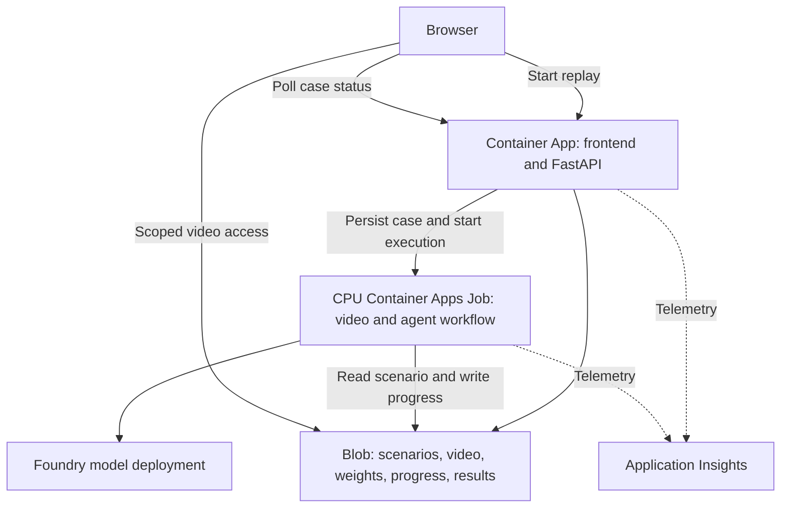

# PitchGuard: Azure serverless deployment investigation

Date: 2026-10-22. Status: researched proposal; no Azure resources created, subscription quotas inspected, workloads benchmarked, or costs measured.

Implementation update (2026-10-23): Foundry v3 and a GPT-4.1 mini deployment are now
available and real calls have run. Application hosting is not deployed. See
[runbook](RUNBOOK.md) and [implementation status](IMPLEMENTATION_STATUS.md). The first
worker reads pre-rendered frames and cutoff-safe history; pose extraction, temporal
training, GPU work and model weights below are superseded planning material, not dependencies.

## Recommendation

The whole application can run on Azure-managed services without a team-managed VM. Azure Functions Flex Consumption is the closest Lambda-style function service. For this project's Python Agent Framework, native video dependencies, and finite replay analysis, prefer Azure Container Apps Consumption plus a CPU Container Apps Job for long processing.

Use one web/API app, one worker job, Blob Storage, Foundry model inference, an image registry, and Application Insights. The frontend can initially be bundled with the API. Static Web Apps is an optional separate frontend when independently hosted static assets are useful. Four logical agents can share the same worker process and Foundry model deployment; four cloud services are unnecessary.

## Options

| Service | Scaling/billing model | Project fit |
|---|---|---|
| Functions Flex Consumption | Event-driven, scale to zero, execution billing; optional always-ready capacity adds charges | Lightweight HTTP endpoints, webhooks and short event handlers; code deployment, not custom containers |
| Container Apps Consumption | Run containers, scale replicas by HTTP/events, CPU/memory seconds and requests | FastAPI, frontend serving, Python/native dependencies and short agent requests |
| Container Apps Jobs | Manual/API, scheduled or event-triggered finite container execution; stops at completion | Video replay analysis, data generation, evaluation, training and headless animation generation within available resource limits |
| Foundry Hosted Agents | Managed code-based agent runtime with per-session compute and idle lifecycle | Optional agent-specific hosting alternative; does not replace static frontend, video assets or all CV processing |

Functions is viable, but Flex does not support custom container deployment. Its current instance choices are 512 MB, 2,048 MB and 4,096 MB. Packaging native video libraries is a reason to prefer containers, not proof that Functions cannot run ML. GPU-enabled Functions on Container Apps is a separate hosting path, not ordinary Flex GPU capacity.

## Suggested flow

1. User opens the site and selects a synthetic scenario. HTTP traffic starts the API app if scaled to zero.
2. `POST /api/analyses` creates a durable case and starts a finite worker execution, returning HTTP 202 and a case ID quickly. A client request ID prevents duplicate submissions. A worker-side claim/lease prevents two executions processing the same case. Retry a failed start using the same case ID.
3. The worker reads immutable pre-rendered frames and cutoff-safe historical summaries and runs the bounded Agent Framework workflow. No pose, training or GPU step is required. Current media ships in the image; Blob persists cases/cache/budgets.
4. Progress, accepted evidence, checkpoints, and results are saved through the Blob SDK. Use version/ETag checks and separate evidence objects rather than competing writes to one shared JSON document.
5. The browser reads video using a limited access URL and polls status through the API. Stop polling on completion, cancellation or inactive viewing. Short reconnectable streaming is a later UI option.
6. A worker execution ends after completing or cancelling the finite replay. The API scales down after inactivity under the selected scaling policy. No managed-by-the-team VM remains running.

Jobs have no HTTP ingress. The API starts the job through an Azure management API using its managed identity; it does not call a web route inside the job. A queue/event-triggered design can replace direct start later if durable dispatch volume justifies it. Grant the API narrowly scoped job-start access and the worker access only to needed storage and Foundry resources.

Do not launch an untracked background thread in FastAPI, return success and assume that the HTTP-scaled app will keep running. Long work belongs in an explicit durable execution with its own lifetime.

## Initial configuration to validate

| Component | Proposed initial setting |
|---|---|
| API hosting | Consumption workload profile; HTTP ingress; minimum replicas 0; maximum replicas 1 |
| API resources | Candidate 0.5 vCPU / 1 GiB, adjust after measuring startup and memory |
| CPU worker | Manual job started by backend; one replica, parallelism 1; candidate 1 vCPU / 2 GiB |
| Worker limits | Example 15-minute timeout for short demo scenarios; 0 automatic replica retries initially; explicit checkpoint/retry path |
| Concurrent analysis | Application-wide single active analysis initially, enforced by durable lease; job parallelism alone does not limit separate executions |
| Frontend | Bundle built static files with API for smallest deployment; optional separate Static Web Apps frontend later |
| Storage | Blob SDK access for durable state; temporary local files only for cache/processing |
| Model | One compatible Foundry deployment; bounded calls/tokens and cached explanations |
| Image | One tested container image with separate API/worker entrypoints is possible; split images if CV dependencies harm API startup |

These are starting configurations, not sufficient-resource claims. The visual dependency set, resolution and model must be profiled. Do not promise real-time frame processing from these resource sizes.

Use a workload-profiles environment if preserving the documented serverless GPU migration path; the GPU feature does not work in legacy Consumption-only environments. CPU use can still select its Consumption profile. Do not add a Dedicated profile or optional networking features without checking additional charges.

## Limits affecting product behavior

- Functions HTTP responses have a documented 230-second limit even when the execution timeout permits longer work. Container Apps HTTP ingress documents a 240-second request timeout. Use submit/status/results rather than one request waiting for an entire video.
- A long function execution timeout is not a durability guarantee. Platform updates/restarts can occur; checkpoint and make replay operations idempotent.
- Cold starts include image pulling, Python imports and model loading. Show a starting/loading state; benchmark cold and warm runs. A warm minimum replica or Functions always-ready setting trades standing cost for responsiveness.
- Continuous live analysis still consumes compute continuously during the match. Serverless saves idle compute; it does not make an active 90-minute video analysis instantaneous or free.
- Stored blobs and telemetry outlive compute. Container/replica-local files do not. Blob is accessed with the SDK, not assumed to be a mounted filesystem.
- For the synthetic demo, render animation ahead of playback and store it in Blob. If rendering must also run on Azure, use a separate finite headless-render job and measure time/cost. Model training can likewise be an on-demand job within available resources.

## GPU path

Start by benchmarking CPU pose extraction on one focused player. Foundry LLM inference uses its managed model endpoint and does not require a GPU in the application container.

If vision actually needs a GPU, Azure Container Apps offers serverless NVIDIA T4/A100 options with per-second billing and scale to zero. Availability depends on supported region, workload-profiles environment and managed-environment GPU quota. This investigation confirms the documented GPU app path; it does not confirm a GPU Jobs configuration in the user's subscription. Evaluate a separate GPU Container App/worker and its scaling trigger before promising GPU job support.

Do not select the GPU region or buy a standing GPU allocation before verifying quota and the CPU benchmark. The full-system feasibility conclusion does not guarantee instant access to GPU capacity.

## Foundry Hosted Agents alternative

Foundry can also host custom agent code rather than merely serve model calls. Its runtime scales per session, persists session state and releases compute after an idle timeout. Current documentation lists a 15-minute default idle timeout, configurable from 2 to 240 minutes, with CPU/memory billing across active sessions.

This is managed on-demand hosting, but its lifecycle follows a session, not immediate request completion. It is a viable alternative when managed agent sessions are valuable. For the initial video-centered application, Container Apps plus Jobs makes web and video lifetimes explicit while keeping agent orchestration code portable. Do not provision both agent runtimes for the same work by default.

## Costs

Container Apps Consumption documents monthly grants per subscription of 180,000 vCPU-seconds, 360,000 GiB-seconds and 2 million HTTP requests. Apps and Jobs share applicable subscription grants. A zero-replica revision has no resource-consumption charges; Jobs stop consuming compute after completion. This does not make the entire system free.

Illustrative arithmetic, not measured usage: 100 ten-minute runs at 1 vCPU / 2 GiB use 60,000 vCPU-seconds and 120,000 GiB-seconds, excluding API runtime, startup and retries. Whether any grant remains depends on other subscription usage. GPU charges and model inference are separate.

Budget separately for Foundry inference, Blob capacity/operations, registry storage/builds, Application Insights/Log Analytics, network transfer and any optional networking/hosting features. Azure Container Registry has its own pricing. No fixed monthly total is estimated without chosen region, model, runtime and usage volume.

Set max replicas, execution deadlines, cancellation, cross-request concurrency limits, LLM budgets and log retention. Restrict allowed scenarios/durations on public demo endpoints. Cost Management budgets notify; they do not automatically stop all spending. Scale to zero means no retained compute at zero, not no storage bill and not immediate shutdown after the final request.

## Human setup and deploy sequence

1. User/admin confirms subscription, billing intent and permissions and completes interactive sign-in.
2. Create or reuse the Foundry project and one model deployment; confirm quota and perform a model smoke test.
3. Select CPU-compatible region, create a resource group, workload-profiles Container Apps environment, Blob storage and image registry, and connect telemetry.
4. Build/push the tested application image; create the API app and CPU job with explicit scale/resource/deadline settings.
5. Configure managed identities for model calls, Blob reads/writes, image pull and API-to-job start. Local `az login` credentials are not deployment credentials.
6. Upload versioned synthetic assets/model weights; configure endpoints and model deployment name in backend settings, never frontend secrets.
7. Run full cloud smoke tests: cold start, submit/poll/result, visual extraction, agent tools, trace, cancellation, duplicate submission, failed job and durable restart.
8. Verify idle scale-to-zero and actual cost meters. GPU access is a separate prerequisite only if the measured workload requires it.

All routine provisioning and code packaging can be automated after account access, subscription choices and authorization exist. Authentication/MFA, account eligibility, accepting relevant billing/terms and administrator-only grants may require the user or administrator. No deployment was performed by this investigation.

## Sources checked 2026-10-22

- [Functions Flex Consumption](https://learn.microsoft.com/en-us/azure/azure-functions/flex-consumption-plan).
- [Functions hosting, containers and HTTP timeouts](https://learn.microsoft.com/en-us/azure/azure-functions/functions-scale).
- [Container Apps scaling](https://learn.microsoft.com/en-us/azure/container-apps/scale-app).
- [Container Apps Jobs](https://learn.microsoft.com/en-us/azure/container-apps/jobs).
- [Container Apps billing and grants](https://learn.microsoft.com/en-us/azure/container-apps/billing).
- [HTTP ingress limits](https://learn.microsoft.com/en-us/azure/container-apps/ingress-overview).
- [Ephemeral and persistent storage](https://learn.microsoft.com/en-us/azure/container-apps/storage-mounts).
- [Serverless GPUs](https://learn.microsoft.com/en-us/azure/container-apps/gpu-serverless-overview).
- [Foundry Hosted Agents lifecycle and billing](https://learn.microsoft.com/en-us/azure/foundry/agents/concepts/hosted-agents).
- [Static Web Apps](https://learn.microsoft.com/en-us/azure/static-web-apps/overview).
- [Azure Container Registry pricing](https://azure.microsoft.com/en-us/pricing/details/container-registry/).
- [Azure Budgets behavior](https://learn.microsoft.com/en-us/azure/cost-management-billing/costs/tutorial-acm-create-budgets).
