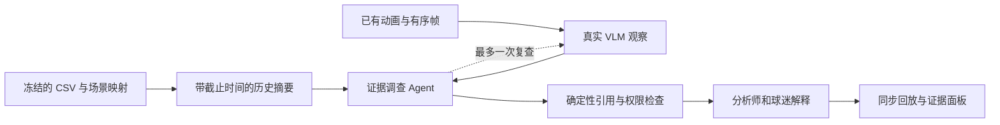

# PitchGuard AI 实施计划与文档审阅

日期：2026-10-23（America/Toronto）。本文件用于团队内部执行；提交页面、界面、演示视频和评委运行说明使用英文。

更新：用户随后授权实施，本地应用、真实推理和部署准备已经推进。下文保留开工前的审阅基线；当前完成情况、实测失败与未交付部分以 [IMPLEMENTATION_STATUS.md](IMPLEMENTATION_STATUS.md) 为准。

**建议先完成一个可复现的闭环：已有动画 + 截止到比赛前一天的历史摘要 → 真实视觉推理 → 证据调查与一次有界复查 → 分析师/球迷两种解释。** 当前数据足以支撑合成原型，尚不足以支撑经过验证的伤病概率。近期工作重点是数据适配、真实模型联调和端到端交付。

本次已完成文档审阅、GitHub 原始文件下载和 CSV 核查；以下工作包是后续开发安排，不能视为已实现功能。未部署 Azure、调用付费模型、提交或推送代码，也未改变仓库可见性。

## 1. 当前基线

| 项目 | 本次确认的状态 | 对实施的影响 |
|---|---|---|
| 本地代码 | 分支 `feat/synthetic-animation`，HEAD `6e92671120b3e265208b622bc6fb05ee1c6ac232`；已有未提交的架构、动画脚本等修改 | 保留当前工作区，按文件下载数据；未对整个分支执行 merge/rebase/pull |
| GitHub | `DrBoom-233/Premier_League_Hackathon`，默认分支 `main`，当前 private | 提交比赛前需要公开；发布前检查源文件、素材与密钥 |
| 数据快照 | `main` 的 `6c2d27bf0d64bdbfa0299989bcc64bcad876b058` | 后续结果以此 commit 和输入哈希复现，不直接依赖浮动的 main |
| 动画 | S001–S003 各 10 秒；R001 参考片段 3 秒；已有本地视频、PNG 序列、时间清单和生成记录 | 复用素材；大文件被忽略，新 clone 不会自动得到视频 |
| 动画验收 | 既有媒体检查记录通过；792 帧；人工标注仍为 `pending_human_review` | 媒体格式通过与动作可读性通过分别验收 |
| VLM | 现有 `run_vlm.py` 适配器和输入 dry run；记录为 `not_run` | 尚未证明模型识别能力、API 兼容性、延迟或成本 |
| 应用 | `src/` 尚无应用实现 | API、界面、Agent 编排、部署和评测均需安排 |

### 已拉取的文件

| 本地文件 | 内容 | 规模 |
|---|---|---|
| [`data/daily_records.csv`](../data/daily_records.csv) | 球员日级负荷、恢复状态和衍生列 | 7,000 行 × 37 列 |
| [`data/injury_history.csv`](../data/injury_history.csv) | 伤病事件 | 30 行 × 9 列 |
| [`data/source/hackathon_injury2.0.py`](../data/source/hackathon_injury2.0.py) | 同一远端快照中的新版生成器，供审阅和来源留档 | 19,828 bytes |
| [`data/source_manifest.json`](../data/source_manifest.json) | 来源 commit、路径、大小、Git blob SHA-1、SHA-256 | 三个文件均已逐字节校验 |
| [`data/data_profile.json`](../data/data_profile.json) | 本次 CSV 核查结果及问题样例 | 机器可读检查记录 |

下载的 CSV 保持原样。生成器和 CSV 同处一个 commit，尚未通过重新运行生成器证明二者逐值一致。远端下载不等于已把本地分支与 main 合并。

## 2. 各文档审阅结论

| 文档 | 结论 | 后续修订动作 |
|---|---|---|
| `README.md` | 项目概念/技术尚未确定的文字已过时；“实现待完成”也没有区分已完成动画与未完成应用 | 更新为 PitchGuard、当前真实状态、启动方法及本计划入口 |
| `CONTRIBUTING.md` | 现有协作流程可用 | 为数据变更补充输入哈希和核查结果；现有分支无需重建 |
| `docs/PROJECT_BRIEF.md` | 仍是 TBD 模板，是产品描述的主要缺口 | 填入用户、核心演示、MVP、技术理由和实际团队职责；未确定成员保持待定 |
| `docs/ARCHITECTURE.md` | 无训练、历史统计 + VLM、证据调查、双受众方向可执行 | 删除末尾针对旧生成器的过时问题；落实统一状态和字段定义 |
| `docs/DECISIONS.md` | 仅记录仓库初始化，未记录后续范围收敛 | 将动画路线、概率不提供、无训练、部署选择写成待确认/已确认的独立条目，明确状态 |
| `docs/HACKATHON_BRIEF.md` | 主线与本次复核的官方要求一致 | 发布前再次检查截止时间、注册/资格、公共代码与测试链接、英文材料 |
| `docs/SCORING_STRATEGY.md` | 评分映射和多 Agent 对照合理；10 月 22 日 VLM 里程碑尚未达成 | 按本计划重排日期；把真实模型结果和公平基线作为验收项 |
| `docs/AZURE_SERVERLESS_DEPLOYMENT.md` | App + Job + Blob 的部署方向可保留；仍写有姿态提取、时序模型、权重和 GPU 首测 | 首版 worker 改为读取预渲染帧、历史摘要和 Agent 推理；不把姿态、训练或 GPU 列为依赖 |
| `docs/SYNTHETIC_ANIMATION_PLAN.md` | 已能区分制作、人工验收和 VLM 联调，且明确了 S002/S003 同组 | 保留制作方案；补人工验收、模型联调和实际失败，不重复渲染整套素材 |
| `docs/SUBMISSION_CHECKLIST.md` | 基本交付项齐全，但没有运行证据和责任人 | 增加干净环境复现、云端冷启动、错误降级、数据来源、视频重现和提交负责人 |
| `data/README.md` | 仅写“Training data”，容易把本次工作导向训练 | 以原始快照、派生数据、运行时允许字段、离线标签区分用途 |
| `data/animation/README.md` | 素材接口/重建说明清楚；目前 10 当前帧 + 3 参考帧的请求安排需要调整 | 同步新的单请求图片预算，并说明真实推理验证状态 |
| `data/animation/generation_notes.md` | 有制作测量、版本和局限，能作为 provenance | 保留测量与人工验收的区别，补团队第二台机器复现记录 |
| `Data variability.pdf`（两页） | 是长期运动科学数据需求，目标是未来 7 天非接触、time-loss injury | 作为字段/单位依据；近期不承诺已校准概率，明确 HSR 阈值、问卷方向和恢复日期语义 |

本次在本计划中集中记录修订事项，未批量改写旧设计，也未将建议记作团队已经同意的决策。

## 3. 数据核查及使用限制

### 数据覆盖和已经通过的检查

- 25 名球员，每人 280 条日记录；日期范围为 2025-08-01 至 2026-05-07。
- 30 次伤病：20 次 Non-contact、7 次 Contact、3 次 Unknown。日记录中 `injury_next_7d=1` 有 140 行，表示重叠的球员日窗口，不是 140 次独立伤病。
- 已按原始伤病表重新核对未来 7 天非接触标签，0 处不一致；排除标记 0 处不一致。末尾 7 天共 175 行被排除；总排除 573 行，剩余 6,427 行中 137 行为正标签。这些计数仅描述合成数据。
- 球员日期重复键、伤病 ID 重复、孤立伤病球员、伤病日期与 `days_lost` 不一致均为 0。
- `srpe_load=(match_minutes+training_minutes)×session_rpe`、`load_7d`、`hsr_7d`、`sprint_7d` 重算检查均通过；问卷评分和 RPE 范围检查通过。
- 新版生成器已统一疲劳评分“1 好、5 差”，标签限定 Non-contact，并增加 `exclude_from_training`。旧架构列出的这三项不能继续作为待修复缺陷。

### 仍需处理的问题

| 优先级 | 实测发现 | MVP 处理方式 |
|---|---|---|
| P0 | `load_change_pct` 有 20 个无穷值 | 原始 CSV 留档；派生层将零分母/非有限值转为 `null` 并附原因，不向模型或严格 JSON 输出 Inf/NaN |
| P0 | `matches_last_14d` 与实际 `match_minutes>0` 的滚动计数有 3,528 行不同 | 若指标表示球员出场次数，重新计算；如保留日历比赛次数，另命名并显示口径 |
| P0 | 5 行 `hsr_distance > total_distance` | 标记不一致；相关距离及受影响的窗口汇总不用于解释，不静默修改原始值 |
| P0 | 559 行 `sprint_distance > hsr_distance`；PDF 未固定阈值或区间是否包含 | 先定义 Sprint 是否为 HSR 子集；口径未明确前不解释两者关系或比值；若包含则作为质量错误处理 |
| P0 | 30 次伤病的 `return_to_training_date` 都早于 `injury_end_date`，但生成器持续停训至 end date | 与 PDF“完整、不受限制训练”的定义冲突；暂不发布“恢复完整训练天数”，用发生日期和受影响天数并注明模拟口径 |
| P0 | CSV 没有日内可用时间、比赛 ID 或与动画的直接连接 | 建立显式 scenario mapping；历史仅使用比赛日前的已完成日记录；全天比赛汇总不当作第 68 分钟已知信息 |
| P1 | `load_28d` 缺失 150、`acwr` 缺失 197、`load_change_pct` 缺失 265、个人 z-score 缺失 9 | 区分窗口未满、零负荷和零方差；不一律补零。首版可直接不使用 ACWR/z-score |
| P1 | `load_28d` 从第 7 天就开始输出；`load_change_pct` 是每日比较相邻的滚动 7 天值 | 显示窗口实际覆盖天数；新指标明确使用非重叠前后 7 天窗口，避免把不同定义混称“周环比” |
| P1 | PDF 的 `days_since_last_match` 未提供；无独立赛内事件流 | 从过去实际出场记录计算；生成中性回放事件，不手填“AI 已检测到异常” |

不要用 ACWR、单次睡眠/HRV 或模拟器内部概率直接换算真实伤病风险。MVP 的输出为 `routine / review / insufficient_evidence` 之类的原型关注状态；显示证据和限制，`injury_probability: null`、`probability_status: not_validated`。

## 4. 首版体验和数据接口

### 场景和统一时钟

继续使用 S001（稳定活动）、S002（减速停步）、S003（相同动作被遮挡）和独立 R001 参考。场景意图只进入制作/离线评估材料，不进入 VLM 输入。人工观看完整视频后才填写标注。

建议将三个演示场景统一映射到虚构球员 P001（CSV 中为 CB）和合成比赛日期 **2026-01-25**。这只是新建演示上下文，不代表动画来自 CSV 所记录的真实动作。该日有 79 分钟模拟出场记录，可用于选择演示日期，但其全天总负荷不进入第 68 分钟的历史摘要。选择依据不使用未来伤病标签。

首版历史截止为 **2026-01-24 日终**：日数据筛选 `date < match_date`，伤病表只暴露在截止时已经发生且当时可知的字段。既往伤病发生日期可用；如果结束/恢复日期还在未来，不能把最终日期与最终 days_lost 当成当时已知事实。既往伤病次数和距发生时间按事件表在截止时重算，不直接照搬某行预先计算的列。

`scenario_mapping` 至少包含 `scenario_id / player_id / match_id / match_date / history_cutoff / current_clip_id / reference_clip_id / match_start_ms / input_revision`。保持现有时钟：R001 从 67:00 开始；当前片段从 68:00 开始；`match_time_ms = match_start_ms + clip_time_ms`。

### 历史摘要和证据

普通代码计算过去 7 天 sRPE、前一个不重叠 7 天 sRPE、28 天总量与有效天数、7 天比赛/训练分钟、实际出场次数、距上次出场天数、疲劳/睡眠/酸痛汇总、截至当时已知的伤病事件及缺失情况。变化率分母为零时返回不可用。所有数值带单位、窗口、定义版本和来源 ID。

证据 ID 可采用 `daily:P001:2026-01-24` 和原有 `INJ_P001_0001`；CSV 对应行及文件 SHA-256 留在服务端索引。历史 Agent 只能通过 `get_history_summary` / `get_history_evidence` 访问允许字段；动作 Agent 只能访问 runtime 帧和参考帧。禁止将完整 CSV、生成器、制作配置、评估标注、`injury_next_7d`、`exclude_from_training` 或未来伤病记录塞入提示词。

### 最小流程

History 和 Motion 两个角色并发；Investigator 在证据汇合后决定接受、拒绝或指定区间复查；Narrative 只使用已通过检查且按受众过滤的事实。四个逻辑角色共用一个兼容部署和一个 worker，无需四套云服务。

统一当前脚本和架构里不同的枚举：动作 `view_status=clear/partial/obscured`；`review_status=no_clear_change/review/insufficient_view`；工作流状态与这些观察状态分开。每条观察都要有自己的 `evidence_ids`，包含 player、窗口和来源版本。具体 schema 在工作包 W2 冻结，不能让各角色分别猜字段。

## 5. 实施工作包

时间为规划人时，不是完成保证；成员可兼任，尚未指定真实姓名。依赖必须按序满足；同一时间独立准备文案、数据字典和 UI 草图即可，无需先扩大基础设施。

| 工作包 | 依赖 / 估计 | 具体任务与建议交付路径 | 验收条件 |
|---|---|---|---|
| W0 数据适配与场景绑定 | 当前快照 / 4–6h；数据负责人 | 增加 `src/backend/history.py`、数据字典、`data/processed/` 摘要和场景映射；实现上述质量标志与白名单 | P001 的截止时间、7/28 天窗口及源引用可手工追溯；未来标签、赛后汇总、无穷值不进入模型 |
| W1 真实视觉最小验证 | 可与 W0 独立 / 2–3h；模型负责人 | 人工检查 S001–S003；调整 `run_vlm.py` 请求预算；验证一个 Foundry 部署和结构化响应；保存真实结果 | 三段都有真实成功或失败记录、输入帧、模型/提示版本、usage、延迟；支持正常、变化、遮挡的区分或诚实拒绝 |
| W2 领域合同和工具 | W0、W1 / 3–5h；后端负责人 | 增加 `schemas.py`、`tools.py`；冻结 case、观察、历史证据、发布结果；只读工具和身份/时间校验 | 错球员、错版本、未来历史、未发送帧和越界路径被拒绝；单条观察可定位证据 |
| W3 Agent 工作流 | W2 / 5–7h；Agent 负责人 | Agent Framework 实现两专员 → 调查 → 检查 → 解释；共享不可变输入 revision、一次定向复查、调用预算和失败状态 | 一次真实工具驱动复查出现在 trace；遮挡无法消除时保留未知；失败分支不会被包装为成功 |
| W4 API 与回放界面 | W2 后可用明确标记的 fixture 开发；接 W3 真结果 / 4–6h；前端负责人 | FastAPI + React；场景选择、视频/事件时间线、状态、源帧、历史窗口、受众切换和确认记录 | 从界面触发真实分析；点击证据可跳到画面；区分视频时间与分析延迟；球迷模式不泄露恢复问卷等内部信息 |
| W5 评测与成本记录 | W3、W4 / 4–6h；评测负责人 | 人工标注、失败用例、单 Agent 公平基线、`evaluation/` 结果表；trace、调用量、延迟和费用证据 | 所有运行含失败都入表；重复输入不重复付费；无未经支持的百分比或诊断；样本数量和局限明确 |
| W6 托管与提交准备 | 本地闭环、账号权限、W5 核心检查 / 5–8h；发布负责人 | 一套镜像、Container App/API、CPU Job、Blob、遥测；英文项目简介、运行说明、首版视频 | 外部浏览器能测试；冷启动/重启保留结果；公开仓库和 <120 秒视频准备好；提交负责人完成发布检查 |

建议按需新增文件，复用现有 `motion.py` 的抽帧/时间逻辑和既有输入校验。无需新建独立服务、消息队列、向量数据库或训练框架。上述路径是实施目标，除明确标注的现有文件外尚未创建。

### W1 的明确阻塞项：请求图片数

当前 `run_vlm.py` 初次发送 10 张当前帧 + 3 张参考帧；复查继续累加最多 8 张，单次可能变成 21 张。2026-10-23 查询的 Azure 视觉 Chat Completions 文档列出每次请求最多 10 张图。因此 dry run 通过不能证明真实请求能通过。[官方视觉接口说明](https://learn.microsoft.com/en-us/azure/foundry/openai/how-to/gpt-with-vision#api-details)

第一轮先使用 **7 张当前帧 + 3 张参考帧**。复查重新构建请求，最多 **8 张区间帧 + 2 张参考帧**，附必要的前次文字观察；不累积发送前一轮所有图片。精确部署/API 的支持范围仍以实际 smoke test 为准。帧数变化后同步脚本测试、动画 README、manifest/结果记录和费用预算。

如果模型看不出受控片段，先收窄动作/镜头与修改抽帧；不以制作标签替代推理，不默认增加姿态模型。若当天仍不能成功调用模型，将它列为真实阻塞，先完成数据/API/UI 工作，不能把离线模板结果说成真实 Agent 分析。

## 6. API、托管和调用预算

### 建议 API

| 接口 | 行为 |
|---|---|
| `GET /api/scenarios` | 返回可用场景、视频和中性上下文，不返回隐藏动作标签 |
| `GET /api/scenarios/{id}/events` | 返回可回放的中性事件和时间戳，避免把预设检测结果当作推理结果 |
| `POST /api/analyses` | 允许列表内的 scenario/player/window 和 `client_request_id`；尽快返回 202 + case ID；相同请求合并 |
| `GET /api/analyses/{id}` | 返回排队/运行/完成/降级/失败状态、可见结果、revision 和 trace ID |
| `GET /api/analyses/{id}/evidence/{evidence_id}` | 按受众和 case 权限返回证据，只接受已登记 ID |
| `POST /api/analyses/{id}/acknowledgements` | 记录人工查看/确认；不把点击当伤病真值 |

### 最小 Azure 部署

React 构建产物由 FastAPI Container App 提供；CPU Container Apps Job 执行有限分析；Blob SDK 存版本化素材、case 和结果；一个 Foundry 兼容模型部署负责推理，Application Insights/OpenTelemetry 留 trace。动画预渲染，不在评委每次点击时重建。

本地开发可暂用进程内状态；托管前将任务创建、状态和结果持久化。API 先写 case 再启动 Job；同一 case 使用执行 claim、全局并发 lease 和 ETag，防止重复调用及互相覆盖。Job 启动失败可对原 case 重试，不能悄悄丢失。重启后将失联任务标为可恢复/失败，由显式重试继续；不在 HTTP 返回后依赖一个无追踪的后台线程继续运行。[有限任务说明](https://learn.microsoft.com/en-us/azure/container-apps/jobs)、[容器本地存储生命周期](https://learn.microsoft.com/en-us/azure/container-apps/storage-mounts)

初始全局并发 1；App max replicas 1；单次处理 deadline 建议 180 秒（需要实测调整）。每个 case 常规为历史、动作、调查、叙述约 4 次模型调用；最多一次动作复查和一次调查补充，总硬上限 6 次；首版不自动重试模型请求。复查须同时满足剩余时间、图片和调用预算。超时后发布已验证的可用分支并显示缺失；取消在调用之间生效，在途请求可能已产生费用。

单次模型完成 token 起始上限 900，可按角色调小；模型兼容性和输出截断必须实测。先缓存历史摘要和历史推理，再按 frame manifest、player/window、prompt/model revision 缓存动作；受众解释缓存包含 audience/language。记录 cache hit，不能把命中缓存的延迟报告为新推理延迟。

上线前配置每 session/每天请求上限和 token/image 上限，使用选定模型的实际单价记录或保守预留调用费用；unknown 费用状态不能展示为 $0。推理、存储、日志、registry 和计算分别记账。金额上限、币种、Azure subscription/region 由团队在开通前确定，本计划不预先假定已有付费授权或配额。Azure Budget 提醒不会自行停止消费，仍需应用端调用限制及资源配置。[预算行为](https://learn.microsoft.com/en-us/azure/cost-management-billing/costs/tutorial-acm-create-budgets)

Agent Framework 的编排能力用于真实角色交接；追踪按实际运行环境接入，外部运行的 Agent 要验证 exporter/身份关联，不能仅设置环境变量就宣称 Foundry 中已有 trace。workflow/external agent tracing 仍有 Preview 范围；保留本地结构化 trace 和 UI 调用记录供核查。[编排文档](https://learn.microsoft.com/en-us/agent-framework/workflows/orchestrations/)、[Foundry tracing](https://learn.microsoft.com/en-us/azure/foundry/observability/how-to/trace-agent-framework)

## 7. 验收和评测

现有三段是联调集，不计作留出泛化评测；S002/S003 是同一基础动作的变体，不能分到调参与留出两侧。通过最小联调后，争取制作至少 3 个新的独立基础动作实例及其受控变体。10–15 个端到端用例可由视频实例与失败注入构成，报告时分别列出独立动作数和系统用例数；来不及时如实降低样本数量。

| 检查 | 必须出现的行为 / 记录 |
|---|---|
| 历史 cutoff | 注入未来伤病、赛后负荷和隐藏标签后，运行时请求不能读取这些字段 |
| 数值和缺失 | 0 分母、Inf、窗口不满、缺失日记录有明确状态；无缺失值被假装为正常零值 |
| 动作与定位 | 对人工已审阅的可见活动和变化逐条核对；引用帧均真实发送，且与声称的时间/人物一致 |
| 遮挡与错身份 | 遮挡不可判时拒绝推断；错误 player/revision 被拒绝；复查不会恢复不存在的视觉信息 |
| 编排与失败 | 模型超时、无视频、无历史、错误 JSON、请求图片超限和预算耗尽有可见降级；整例和逐分支状态可追溯 |
| 同步与幂等 | 视频跳转后证据仍按比赛时钟定位；重复提交共享 case；云端重启不丢已完成结果 |
| 受众与发布 | 球迷解释只接收过滤后的可见比赛事实；原型关注状态不被包装成诊断/概率 |
| 成本和速度 | 逐例记录总耗时、各角色耗时、usage、图片数、调用数、重试、缓存、实际费用或待计算状态；冷暖启动分开 |

对照单 Agent 和多 Agent 时使用相同历史截止、输入图像、工具权限、模型、总调用/token/deadline 上限和独立场景；允许双方在预算内选择是否复查。单独报告实际额外调用、成本、失败和无收益案例。多人角色图不是效果证明，不强求多 Agent 一定获胜。

发布要求：未来标签泄漏、引用伪造、错误身份和未经验证概率的测试失败数为 0；观测质量由人工审阅后报告计数/分母。小样本只报告描述性结果，不报告伤病预测 accuracy。没有足够实际请求时不计算看似精确的 p95；展示所有实测耗时和样本数。

## 8. 10 月 23–27 日排期和取舍

| 多伦多日期 | 里程碑 | 当天退出条件 |
|---|---|---|
| 10 月 23 日 | W0 数据口径、场景 mapping；W1 单部署真实 VLM 最小验证 | 历史输入可追溯；S001–S003 有真实结果或明确接口/画面阻塞；优先修 13/21 张图问题 |
| 10 月 24 日 | W2/W3 证据合同和编排；W4 基础回放 | 单一 case 从原始输入到解释跑通；至少一个复查/拒绝案例有真实 trace |
| 10 月 25 日 | W4 双受众、W5 失败用例和对照；启动 W6 托管 | 冻结功能范围；界面可查看来源；核心边界检查通过；开始外部访问测试 |
| 10 月 26 日 | 云端冷启动/持久性检查、英文说明、指标表、第一版录屏 | 外部浏览器可重现核心演示，视频无需等待缺失功能；部署问题有缓冲时间 |
| 10 月 27 日 | 修阻塞问题、确认仓库公开和可复现、完成提交 | 建议多伦多 20:00 前提交，保留时差/上传缓冲；不再增加核心依赖 |

官方截止为 2026-10-27 23:59 Pacific，即 **2026-10-28 02:59 Toronto**。注册截止与提交截止不同；团队代表仍需核实已注册/资格及成员不超过四人。评委测试访问持续至官方评审期结束。以上日期及公共仓库、英文材料、可测试链接、视频严格少于两分钟的要求在 2026-10-23 复核。[官方规则 §1、§3、§4](https://github.com/microsoft/insidethegamehackathon/blob/main/OFFICIAL%20RULES.md)

出现进度不足时，依次删去多语言、更多球员、更多摄像机和额外云组件；保留真实模型链路、来源证据、受众差异和明确失败。取消自定义模型训练、实时整场视频理解、姿态/生物力学服务、校准伤病概率和生产级数据平台这些本轮非必要工作。

## 9. 开工顺序

1. 冻结本次源文件；完成数据字典、白名单、历史截止和 P001 场景映射。
2. 修正单请求图片预算，人工看完三段视频，用实际可用的一个 Foundry 部署做 smoke test。
3. 冻结证据 schema，接入历史和动作工具，再实现 Investigator、Narrative 与一次复查。
4. 接 API/界面，完成失败用例和单 Agent 对照，再托管、录制和提交。

最先需要团队落实的是 Foundry 访问/部署、可接受的账单上限、人工视频审阅者和提交负责人。这些事项不阻止数据适配与本地界面开发，但真实推理与云端发布必须以实际访问和运行结果为准。
