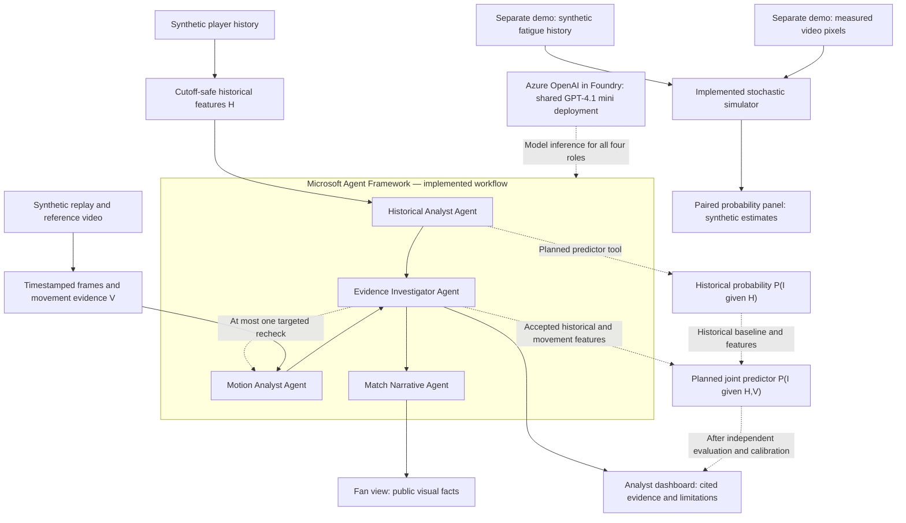

# PitchGuard AI — Connecting Player History with Movement Evidence

PitchGuard AI explores how historical health and workload data can be combined with current movement observations to support football analysts and sports science teams. Our goal is to estimate the probability of a new non-contact, time-loss injury within the next seven days, while making the evidence behind each assessment available for review.

Our team includes a sports science expert who guided the selection of relevant monitoring variables and the definition of the prediction target. We organize the data around previous injuries, match and training exposure, physical workload, and recovery. Candidate variables include injury type and body location, time since a previous injury, match minutes, training duration, session rating of perceived exertion (RPE), sleep duration and quality, fatigue, muscle soreness, and optional physiological measures such as resting heart rate and heart-rate variability (HRV). Running distance, high-speed running, sprinting, and acceleration/deceleration measures are additional candidates once their measurement definitions are consistent. These indicators provide context for modeling; no single measurement establishes that a player will be injured.

Because longitudinal monitoring data are often private, our prototype uses synthetic data. The frozen historical dataset contains 7,000 daily records for 25 fictional players across 280 days, alongside 30 injury events, including 20 non-contact events. We also created procedural Blender animations showing stable movement, slowing, occlusion, and a matched symmetric/asymmetric gait pair. This lets us inspect how the system responds when movement changes while history, camera, speed, and path are held constant.

Before analysis, deterministic code computes complete seven-day and 28-day workload windows, comparisons with the preceding week, recent exposure, recovery summaries, and past injury context. Every input is restricted to information available before the prediction cutoff. Future injury labels remain offline, missing measurements retain explicit availability reasons, and unresolved distance definitions are excluded from the current historical summaries.

The agent architecture separates historical interpretation, visual observation, evidence investigation, and communication. Microsoft Agent Framework coordinates the historical and visual specialists concurrently. The Historical Analyst Agent interprets computed features and cites dated source records. In the intended probability-enabled architecture, it will call a versioned, independently evaluated historical predictor to obtain P(I | H), rather than generate a percentage through language-model reasoning.

The Motion Analyst Agent inspects ordered, timestamped video frames and a separate reference clip. It describes visible changes in activity or gait and records the supporting frames and visibility limitations. Our longer-term goal is to apply this process to successive live video windows. The current implementation analyzes short, prerecorded synthetic replays; continuous real-time tracking and detection latency have not been validated.

The Evidence Investigator Agent reconciles both specialists, checks source identity and timing, and can request one targeted visual recheck. In the target architecture, accepted historical features H and measured movement features V will feed a joint predictor estimating P(I | H, V) for the same event and prediction horizon. The joint model must account for dependence between the inputs. We do not multiply two agent-generated probabilities or treat an observed gait change as proof of injury. The analyst dashboard presents evidence and uncertainty, while the Match Narrative Agent produces a fan explanation using only accepted public visual facts.

Solid arrows represent implemented application paths. Dashed arrows identify shared model access, the optional recheck, or explicitly labeled future probability integration. The probability simulator is a separate demonstration, not an output of the Agent workflow.

Our working probability demonstration combines two synthetic history profiles with measured features from rendered videos across six controlled what-if cases. In the featured gait pair, identical history produces a history-only simulator probability of 9.27%. Conditioning on measured movement gives 4.13% for the symmetric clip and 14.42% for the asymmetric clip. These values follow a declared stochastic event process; they demonstrate that actual video measurements affect the calculation. They are not trained or clinically validated injury predictions. The simulator currently uses fatigue and measured movement state, independently of the broader Agent summaries.

Azure provides the deployed model inference behind the Agent workflow. We use Azure OpenAI in Microsoft Foundry with a GPT-4.1 mini deployment configured through a France Central resource. One deployment serves all four logical roles through distinct prompts, structured outputs, and tool permissions. This supports both text interpretation and image reasoning without operating a separate model server for each agent. Caching, bounded frame inputs, one permitted recheck, and per-case and daily call/token limits control repeated inference.

The application was deployed to Azure on October 26, 2026, using an isolated release. Azure Container Apps hosts the FastAPI/React application, a finite Container Apps Job executes new analyses, Blob Storage persists case, cache, budget, and access-code state, and Azure Container Registry stores the application image. The deployment also includes Application Insights and Log Analytics for telemetry. Managed identities and scoped role assignments support storage access, image pulls, and job dispatch; the model credential remains a server-side secret. Runtime media ships with the application image.

The [public demo](https://pgdemo-web.purpleground-33ee8913.francecentral.azurecontainerapps.io) provides videos, five selected saved analyses, evidence inspection, analyst/fan views, and the six-case probability simulator without login. New analyses require a judge code. Deployment checks verified a complete cloud Agent analysis, duplicate-request handling without a second quota charge, and persistence of the completed case and access-code quota after a web revision restart. Load testing and medical validation are separate from these deployment checks.

PitchGuard's delivered prototype connects historical context, real Azure-powered visual reasoning, inspectable evidence, and a separate multimodal probability simulation. The next step is to train and independently evaluate historical and joint predictors on aligned history, video, and outcome data before integrating validated probability tools into the Agent workflow.

---

## Supporting material

- [Sports science data requirements](../Data%20variability.pdf)
- [Runtime data definitions](../data/DATA_DICTIONARY.md)
- [Source provenance](../data/source/README.md)
- [Paired probability simulator and event law](../data/demo/README.md)
- [Current implementation status](IMPLEMENTATION_STATUS.md)
- [Agent architecture](ARCHITECTURE.md)
- [Deployment and runbook](RUNBOOK.md)
- Isolated Azure deployment evidence: `.state/releases/20261026-azure-v1/DEPLOYMENT_STATUS.md` (private local record; do not publish the release folder or its credentials)
- [Microsoft Foundry vision documentation](https://learn.microsoft.com/en-us/azure/foundry/openai/how-to/gpt-with-vision)
- [Microsoft Agent Framework workflows](https://learn.microsoft.com/en-us/agent-framework/workflows/)
- [Azure Container Apps Jobs](https://learn.microsoft.com/en-us/azure/container-apps/jobs)

Team expertise is included based on the project owner's statement. Implementation claims were checked against the repository and the isolated Azure deployment record on October 27, 2026. This description distinguishes the deployed evidence workflow and separate simulator from the planned integrated predictive system.
